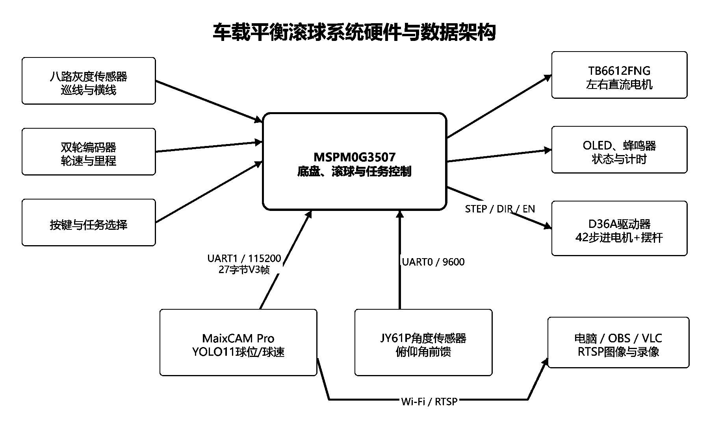

# MSPM0 车载平衡滚球运动控制系统

> A vision-assisted ball-balancing vehicle based on TI MSPM0G3507.

这是一个面向全国大学生电子设计竞赛 H 题场景开发的嵌入式控制项目。系统将小车黑线巡迹、双轮速度闭环、钢球视觉定位、42 型步进电机摆杆控制和姿态前馈整合在一套 MSPM0G3507 固件中，实现车辆运动与滚球平衡的协同控制。



## 项目亮点

- 使用八路灰度传感器完成黑线位置估计、横线识别和丢线恢复。
- 使用双轮编码器 PI 闭环抑制左右电机差异，支持分级速度和短制动。
- MaixCAM Pro 通过 UART 发送球位、球速、置信度和有效标志；MCU侧实现帧校验、超时和异常值过滤。
- D36A驱动42型步进电机调节摆杆，使用人工零位、软行程和方向约束保障无机械限位条件下的安全。
- 任务3采用分段PD、剩余距离速度规划、边界预测和静摩擦/无进展检测，减小折返超调与无效微动。
- 任务4—6使用独立的居中控制器，任务4加入车轮缓加速和摆杆起步前馈，避免任务3参数影响行车平衡。
- JY61P姿态角仅作为有界前馈；数据失效时视觉反馈仍可独立工作。
- 使用非阻塞多周期调度，将巡线、轮速、球位控制、按键和显示分频执行。

## 已实现功能

| 模块 | 实现内容 |
|---|---|
| 底盘控制 | TB6612FNG双电机驱动、编码器测速、轮速PI、差速巡线 |
| 路径感知 | 八路灰度加权误差、横线检测、失线恢复 |
| 球位感知 | 27字节V3 UART帧、CRC、球位/球速/置信度解析 |
| 摆杆执行 | D36A STEP/DIR/EN驱动、42型步进电机、软行程 |
| 姿态补偿 | JY61P角度解析、零偏记录、限幅前馈 |
| 任务管理 | 任务2—6选择、ARMED/RUN/HOLD/DONE/FAULT状态 |
| 人机交互 | 四按键、OLED状态与计时、蜂鸣器提示 |
| 安全机制 | 急停、通信超时、视觉失效、无进展、软限位保护 |

## 控制架构

```text
八路灰度 ──> 巡线PD ──> 左右轮目标速度 ──> 编码器PI ──> 直流电机

MaixCAM ──> 球位/球速 ──> 任务3或任务4—6控制器 ──> 摆杆目标
JY61P  ──> 姿态角 ──> 有界前馈 ────────────────┘
                                      │
                                      └─> D36A + 42型步进电机 + 摆杆
```

任务3与任务4—6分别维护控制状态和参数：前者针对定点往返与折返稳定性，后者针对车辆行驶过程中的钢球居中，避免两类工况互相干扰。

## 硬件组成

- TI MSPM0G3507主控
- 八路灰度传感器
- TB6612FNG双路直流电机驱动
- 左右轮正交编码器
- MaixCAM Pro视觉模块
- JY61P角度传感器
- D36A步进驱动器
- 42型步进电机与摆杆机构
- SSD1306 OLED、按键与蜂鸣器
- 板载CH340 USB转串口

## 软件与调试工具

- Code Composer Studio（Theia）
- MSPM0 SDK 2.10.0.04 / DriverLib
- SysConfig 1.26.2
- TI Clang 4.0.4 LTS
- Python + PySerial UART BSL烧录与CSV数据采集
- MaixVision + YOLO11球体检测
- OBS / VLC RTSP实时观察与录像回放

## 代码结构

```text
app/            任务状态机、视觉/姿态链路和安全管理
bsp/            电机、编码器、灰度、OLED、UART和步进驱动
config/         硬件映射、控制参数和摆杆方向配置
control/        巡线、轮速、滚球、摆杆和车辆前馈算法
protocol/       MaixCAM与JY61P数据协议解析
src/            主程序入口
docs/           接线、联调和分任务测试说明
targetConfigs/  CCS调试器配置
system.syscfg   SysConfig唯一配置源
```

## 构建

1. 安装 Code Composer Studio、MSPM0 SDK 2.10.0.04 和 SysConfig 1.26.2。
2. 在CCS中选择 **Import CCS Projects**，导入仓库根目录。
3. 检查 `system.syscfg`，生成配置后执行 **Clean Project** 和 **Build Project**。
4. 不要手动修改生成的 `ti_msp_dl_config.c/.h` 或 `Debug/` 内容。

工程包含SEGGER J-Link目标配置；实际样机也使用过板载CH340配合MSPM0 ROM UART BSL下载。

使用UART BSL前安装PySerial：

```bash
python -m pip install pyserial
python tools/uart_bsl_flash.py --image path/to/firmware_bsl.txt
```

## 联调顺序

1. 核对电源、共地、左右轮方向与编码器符号。
2. 调平摆杆并确认 `DIR=0` 抬高右端、`DIR=1` 降低右端。
3. 验证八路灰度顺序、巡线误差符号和横线检测。
4. 检查MaixCAM帧头、CRC、标定标志、球位符号和超时恢复。
5. 先分别闭环调试车轮与滚球，再进行任务4—6协同测试。

更详细的步骤见 [`docs/`](docs/)。

## 工程说明

- 本仓库重点公开MSPM0电控固件及其接口设计；MaixCAM模型和视觉端应用未包含在仓库中。
- 样机没有机械限位开关，上电后必须人工调平并建立零位。
- 参数与机械摩擦、驱动细分、电机电流、供电电压和相机安装位置有关，移植时需要重新标定。
- 本项目用于个人作品集和技术交流，不包含参赛队伍或学校身份信息。

## 可展示的工程能力

- 嵌入式C与分层固件架构
- 多传感器UART协议与安全状态机
- PID/PD、前馈、滤波、限幅及静摩擦补偿
- 电机、编码器和步进执行机构联调
- 视觉测量与实时控制系统集成
- 实车日志采集、问题复现和迭代调参


